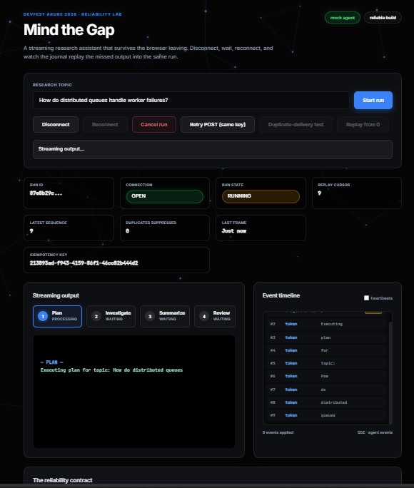

# Streamly (Python)

A Python reimplementation of the DevFest Akure 2026 reliability lab: **Mind the Gap**.

A streaming research assistant that survives the browser leaving. Disconnect, wait, reconnect, and watch the journal replay the missed output into the same run.

## 📸 Visual Proof

### The UI


### Automated Contract Testing (API-First)


### Crash Recovery Worker in Action


---

## Stack
## Stack

- **Backend**: Python 3.14, FastAPI, `asyncio`, `aiosqlite`
- **Frontend**: Vanilla HTML/JS, HTML5 Canvas (reactive background), SSE (Server-Sent Events)
- **Database**: SQLite (WAL mode enabled)

## Quick Start

Requires Python 3.10+.

```bash
# Clone the repository
git clone https://github.com/your-username/streamly-py.git
cd streamly-py

# Create virtual environment
python3 -m venv venv
source venv/bin/activate

# Install dependencies
pip install -r requirements.txt

# Run the server
uvicorn main:app --reload

Open http://127.0.0.1:8000.

The Reliability Contract
The implementation strictly adheres to the five distinct lifecycles and the reliability contract:

Connection is not execution: The run is owned by an asyncio.Task in the RunManager, not the HTTP SSE response. Closing the tab does not abort the agent.

Append, then publish: Every event is committed to SQLite with a per-run sequence number before being pushed to the stream. Reconnect asks for after=<cursor> and replays the gap.

At-least-once, deduplicated: Delivery can repeat. The browser tracks eventId values, ignores duplicates, and persists its cursor in localStorage.

Reconnect is not crash recovery: A server restart can replay committed events, but it cannot resume interrupted computation. A background Recovery Worker claims expired leases and explicitly resumes from the last completed checkpoint.

The 7 Challenges (from the Codelab)
This repository explicitly implements all 7 challenges from page 20 of the codelab:

4th Stage: Added a review stage to the execution loop and UI, verified replay logic.

Backoff & Jitter: Implemented custom exponential backoff with jitter in the browser, overriding native EventSource behavior.

Replay from 0: Added a control to clear state and request ?after=0, rebuilding the transcript without mutating the run.

Idempotent Side Effects: Added a notes table with strict DB-level unique constraints on idempotency_key to prevent duplicated side effects during replay.

Recovery Worker: Added a 15-second lease mechanism and a startup worker that scans for expired leases, parses completed checkpoints, and resumes exactly where the crash occurred.

Retention Policy: Added a bounded retention worker that prunes old runs, returning 410 Gone on reconnect to a pruned run.

Proxy Buffering Failure: Included a proxy.py script to simulate Nginx buffering, proving why heartbeats and X-Accel-Buffering: no are critical for production SSE.

Simulating a Proxy Failure (Challenge 7)
To witness what happens when a proxy buffers SSE (breaking heartbeats and starving the client):
# Terminal 1 (Start the main server)
uvicorn main:app --reload

# Terminal 2 (Start the buffering proxy)
python proxy.py

Then visit http://127.0.0.1:8001 instead of :8000. Start a run, and watch the connection infinitely timeout and reconnect because the proxy is silently swallowing the stream.